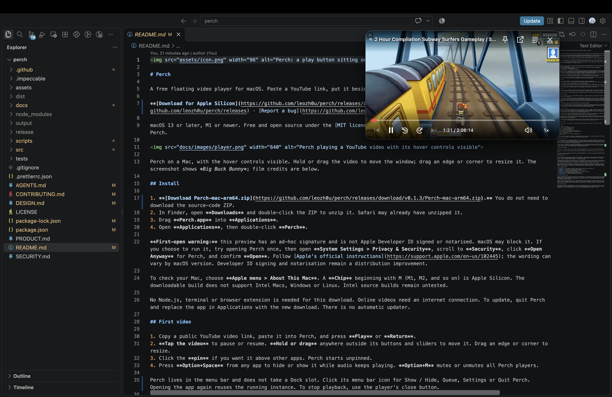
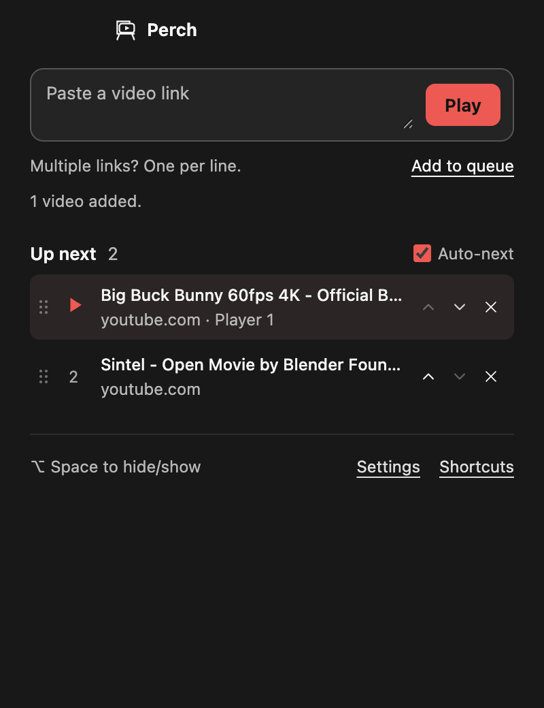
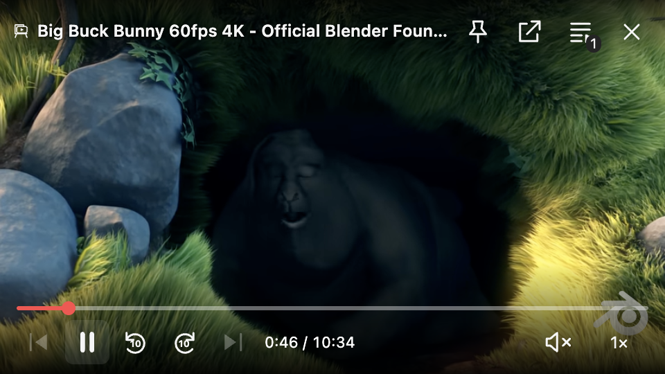

# Perch

A free floating video player for macOS. Paste a YouTube link, put it beside your work, and keep watching as you switch apps.

**[Download for Apple Silicon](https://github.com/leozh0u/perch/releases/download/v0.1.3/Perch-mac-arm64.zip)** · [All releases](https://github.com/leozh0u/perch/releases) · [Report a bug](https://github.com/leozh0u/perch/issues/new/choose)

macOS 13 or later, M1 or newer. Free and open source under the [MIT licence](LICENSE). No account, subscription or API key required by Perch.

Perch floating over VS Code on my Mac. Hold or drag the video to move it; drag an edge or corner to resize it.

## Install

1. **[Download Perch-mac-arm64.zip](https://github.com/leozh0u/perch/releases/download/v0.1.3/Perch-mac-arm64.zip).** You do not need to download the source-code ZIP.
2. In Finder, open **Downloads** and double-click the ZIP to unzip it. Safari may already have unzipped it.
3. Drag **Perch.app** into **Applications**.
4. Open **Applications**, then double-click **Perch**.

**First-open warning:** this preview has an ad-hoc signature and is not Apple Developer ID signed or notarised. macOS may block it. If you choose to run it, try opening Perch once, then open **System Settings > Privacy & Security**, scroll to **Security**, click **Open Anyway** for Perch, and confirm **Open**. Follow [Apple's official instructions](https://support.apple.com/en-us/102445); the wording can vary by macOS version. Developer ID signing and notarisation remain a distribution improvement.

To check your Mac, choose **Apple menu > About This Mac**. A **Chip** beginning with M (M1, M2, and so on) is Apple Silicon. The downloadable build does not support Intel Macs, Windows or Linux. Intel source builds remain untested.

No Node.js, terminal or browser extension is needed for this download. Online videos need an internet connection. To update, quit Perch and replace the app in Applications with the new download. There is no automatic updater.

## First video

1. Copy a public YouTube video link, paste it into Perch, and press **Play** or **Return**.
2. **Tap the video** to pause or resume. **Hold or drag** anywhere outside its buttons and sliders to move it. Drag an edge or corner to resize.
3. Click the **pin** if you want it above other apps. Perch starts unpinned.
4. Press **Option+Space** from any app to hide or show it while audio keeps playing. **Option+M** mutes or unmutes all Perch players.

Perch lives in the menu bar and does not take a Dock slot. Click its menu bar icon for Show / Hide, Queue, Settings or Quit Perch. Opening the app again reuses the running instance. To stop playback, use the player's close button.

## Why I built it

I wanted the little video window from my phone on my Mac, with familiar keyboard controls and a queue of things to watch. Safari and Chrome already have picture-in-picture. Perch puts this workflow in a separate Mac app, so I can close the browser tab and keep watching.

The player has a timeline, volume and speed controls that appear on hover. It also has an optional second player, disabled by default.

## Open and queue videos

Paste a public YouTube video link, a supported HTTPS video URL, or a webpage containing a standard HTML video. Press Play. Drag a link into the link field if you prefer.

To line up more videos, open the queue button or press **Command+O**. Paste several links, one per line. **Add to queue** keeps the current video playing. **Play** starts the first pasted link. Click a queued item to play it. Drag a row or its grip to reorder it; the red line shows where it will land. The small arrows also move rows, and × removes one. Rows slide into place and buttons respond to a press; Reduce Motion removes the movement. Auto-next can advance through the queue when a video finishes. At the end of the queue, playback stops.

Duplicate links are merged, and a batch with an invalid link is rejected before changing the queue. Up to 100 videos can be queued. YouTube titles load when available; an unavailable title does not prevent playback. The queue, preferences and window position are saved locally. On relaunch, Perch opens its link screen rather than automatically playing audio.

## Move, resize and hide

Drag anywhere on the video or the empty parts of its overlay using a mouse or trackpad. A quick click plays or pauses; holding or moving starts a drag. Buttons, sliders and menus keep their normal actions. Drag a window edge or corner to resize it. The player keeps a 16:9 shape and a minimum size of 320 × 180 points. It starts unpinned. Click the pin button to keep it above other apps. It follows desktop Spaces; enable the pin to keep it above other apps, including fullscreen apps.

During a YouTube ad, the site's own controls handle Skip and playback. Click Skip when YouTube makes it available. Drag Perch's title bar to move it during an ad; video-wide dragging and Perch's bottom controls return when the ad ends.

**Option+Space** hides or shows all player windows. It keeps video and audio running, including when auto-next changes videos. The close button pauses playback; with two players open, it closes that player and frees the slot. The last player stays available from the menu bar. **Command+Q** quits and stops playback.

If the global shortcut is already used by another app, Perch reports the conflict rather than replacing that app's shortcut. Use Perch's menu bar icon instead. **Reset position** in that menu recovers a window that is difficult to find.

## Keyboard controls

Playback keys apply to the focused player. They do not intercept typing in other apps or in Perch's link field.

| Key | Action |
| --- | --- |
| Space or K | Play / pause |
| Left / Right | Back / forward 5 seconds |
| J / L | Back / forward 10 seconds |
| Up / Down | Increase / decrease volume |
| M | Mute / unmute focused player |
| Option+M | Mute / unmute all players from any app |
| Command+Shift+Right / Left | Next / previous queued video |
| Command+O | Open queue and links |
| Command+, | Settings |
| Option+Space | Hide / show all players, keep playing |
| Command+Q | Quit |

The timeline, speed selector and controls are keyboard accessible. Arrow keys on a focused slider adjust that slider rather than also seeking the video. Unseekable streams disable the timeline and seek buttons.

## Two videos at once

Open **Settings** and select **Allow two players**. It is off by default. Once enabled, pasting a new link and pressing Play while one video is open creates a second independent player. Both may play audio, and each has its own playback controls. Option+Space hides or shows both together. Option+M mutes both if either is unmuted; press it again to unmute both. Muting does not pause playback. Unmuting a player at zero volume restores its last audible volume.

A third player is refused with an explanation. Repeated Play on a link already open reuses its window. Clicking a queued video selects or replaces a player instead of opening more windows. Automatic queue advancement skips a video that is already open in the other player. Turning the setting off closes the other player and keeps the selected one.

## Build and contribute

Developers can [run from source, test or build a Mac app](CONTRIBUTING.md). End users only need the download above.

Bug reports are welcome through [Issues](https://github.com/leozh0u/perch/issues/new/choose). If Perch is useful to you, I'd appreciate a star.

For security concerns, use [private vulnerability reporting](SECURITY.md). The [security review](docs/SECURITY_REVIEW.md) records what was checked, fixes and limits.

## How it works

Electron provides Chromium playback inside a native macOS panel. `setAlwaysOnTop` and `setVisibleOnAllWorkspaces({ visibleOnFullScreen: true })` provide the floating-window behaviour. The app uses the page's existing `HTMLMediaElement` for play/pause, time, volume and speed. It does not download YouTube streams or run a separate decoder.

A sandboxed preload attaches the compact controls in a Shadow DOM and fits the video to the window. It uses DOM constructors so it works with YouTube's Trusted Types policy. The main process owns windows, queue state, shortcuts and local persistence. Each player has its own source and generation identifier, so stale events from a replaced page cannot update a different video.

Remote pages have no Node integration or privileged `window.perch` bridge. That bridge is only present on Perch's bundled local UI. IPC checks its sender, links are validated, and new windows, downloads and permission requests are denied. Perch adds no analytics or backend. Video websites still receive their normal playback traffic; queued YouTube links also use YouTube's oEmbed endpoint for titles.

| File | Responsibility |
| --- | --- |
| `src/main.cjs` | Native panels, two-player limit, queue coordination, shortcuts and IPC |
| `src/preload.js` | Isolated media discovery and commands |
| `src/player-ui.js` | Hover controls and keyboard-accessible player UI |
| `src/shell.js` | Link field, queue and settings |
| `src/core.cjs` | URL validation, queue creation and display-bounds recovery |
| `src/store.cjs` | Local settings and queue persistence |
| `scripts/package.mjs` | Mac app packaging and local signing |

## Tested and known limits

The app has been tested on an Apple Silicon Mac running macOS 26.6.2. The current checks cover real Electron playback, keyboard and pointer controls, queue changes, opt-in dual players, error recovery and selected remote-page boundaries. Native dragging, resizing, Option+Space, fullscreen behaviour and Option+M were also checked on this Mac. See [verification evidence](docs/VERIFICATION.md) for exact coverage and build versions.

YouTube can change its page structure. Public YouTube playback is the main supported workflow; generic HTML-video pages are best effort. DRM services, private/age-restricted videos, sign-in flows, captions, playlist URLs, full browser-tab mirroring and every streaming site are not promised. Site ads and access restrictions still apply. There is no automatic updater or login item in this version.

## Credits and licence

Perch source is [MIT licensed](LICENSE). The screenshots show *Big Buck Bunny*: (c) copyright 2008, Blender Foundation / [www.bigbuckbunny.org](https://www.bigbuckbunny.org/), [CC BY 3.0](https://peach.blender.org/about/). The film is shown inside the app for demonstration; it is not bundled with Perch. The desktop screenshot shows Subway Surfers gameplay; the game and video retain their owners' rights. Electron and other dependencies retain their own licences.
