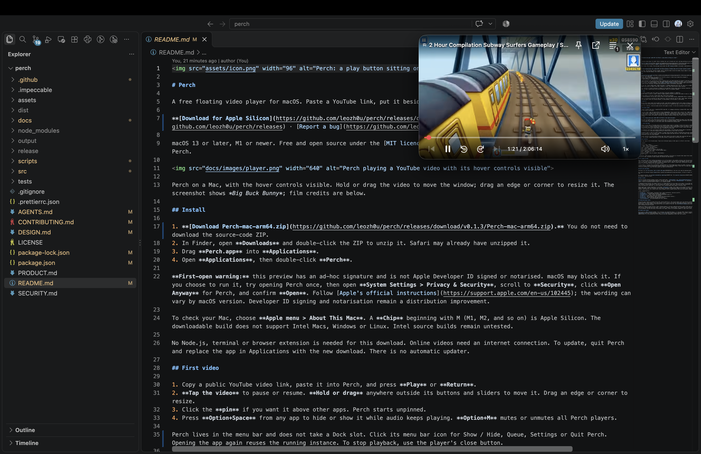

# Perch

A free floating video player for macOS. Paste a YouTube link and watch beside your work.

**[Download for Apple Silicon](https://github.com/leozh0u/perch/releases/download/v0.1.7/Perch-mac-arm64.zip)** · [All releases](https://github.com/leozh0u/perch/releases) · [Report a bug](https://github.com/leozh0u/perch/issues/new/choose)

Requires macOS 13 or later and an Apple Silicon Mac (M1 or newer). No account, subscription, API key or browser extension needed by Perch.

## Install and launch

1. Download **Perch-mac-arm64.zip** above, then double-click it to unzip. Use the app download, not GitHub's source-code ZIP.
2. Drag **Perch.app** into **Applications**.
3. Open **Finder > Applications > Perch**. You can also press **Command+Space**, type **Perch**, then Return.

This preview is ad-hoc signed, not Apple Developer ID signed or notarised. If macOS blocks it and you trust the download, try opening it once, then use **System Settings > Privacy & Security > Open Anyway**. See [Apple's first-open guide](https://support.apple.com/en-us/102445).

Perch lives in the **top menu bar**, with no Dock icon. **Option+Space only works while Perch is running**; it does not launch the app. Reopening Perch reveals the existing player. A fresh launch shows the link field rather than starting playback.

To update, quit Perch and replace the app in Applications with the new download. There is no automatic updater.

## Use it

1. Paste a public YouTube link and press **Play** or **Return**.
2. **Tap the video** to pause or resume. **Hold or drag** outside buttons and sliders to move it; drag an edge or corner to resize.
3. Click the **pin** to stay above other apps. Perch starts unpinned.

Hover for playback, timeline, volume and speed controls. **CC** toggles captions when available; a chapter menu appears when YouTube provides chapters.

Open the **queue** with **Command+O**. Paste multiple links, one per line; **Add to queue** keeps the current video playing. Drag rows to reorder, or click one to play it. For two simultaneous videos, enable **Settings > Allow two players**. It is off by default.

| Shortcut | Action |
| --- | --- |
| Option+Space | Hide/show players; keep audio playing |
| Option+M | Mute/unmute all players |
| Space or K | Play/pause |
| Left / Right | Back/forward 5 seconds |
| J / L | Back/forward 10 seconds |
| M / C | Mute / toggle captions |
| Command+Q | Quit and stop playback |

Option+Space and Option+M work from other apps. Playback keys need the player focused. The player's close button stops its playback; hiding with Option+Space keeps it running.

If a window is hard to find, use the menu bar's **Reset position**. If another app owns the shortcut, use the menu bar instead. [Full controls and queue guide](docs/USAGE.md).

## Why I built it

I was practising on Zetamac while listening to a video and wanted to watch it in my peripheral vision too. So I built a small Mac player with familiar controls and a queue.

## Limits and development

This is a preview. YouTube playback can be intermittent, and site changes can affect controls. Ads and source restrictions still apply. Other HTML video pages are best effort; the download does not support Intel Macs, Windows or Linux.

Queue and settings stay on your Mac. Perch adds no analytics or backend; video sites receive normal playback traffic. See [build-specific verification](docs/VERIFICATION.md), [build and architecture](CONTRIBUTING.md) or [security reporting](SECURITY.md).

## Credits and licence

[MIT licence](LICENSE). The desktop photo shows Subway Surfers gameplay; its game and video retain their owners' rights. The player-guide screenshot shows [*Big Buck Bunny*](https://www.bigbuckbunny.org/), copyright 2008 Blender Foundation, [CC BY 3.0](https://peach.blender.org/about/). Videos are not bundled with Perch. Dependencies retain their own licences.
