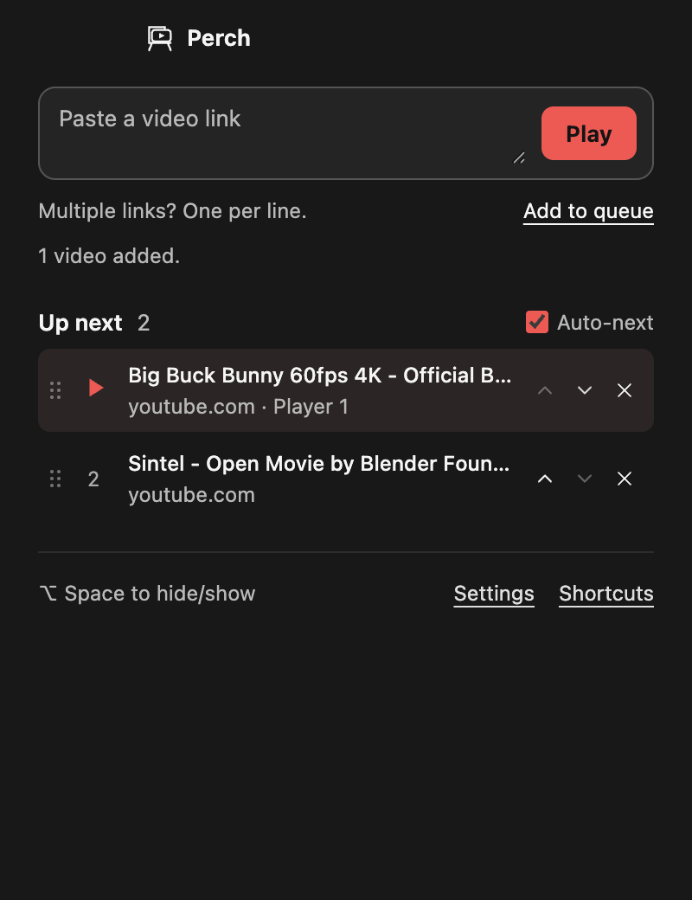
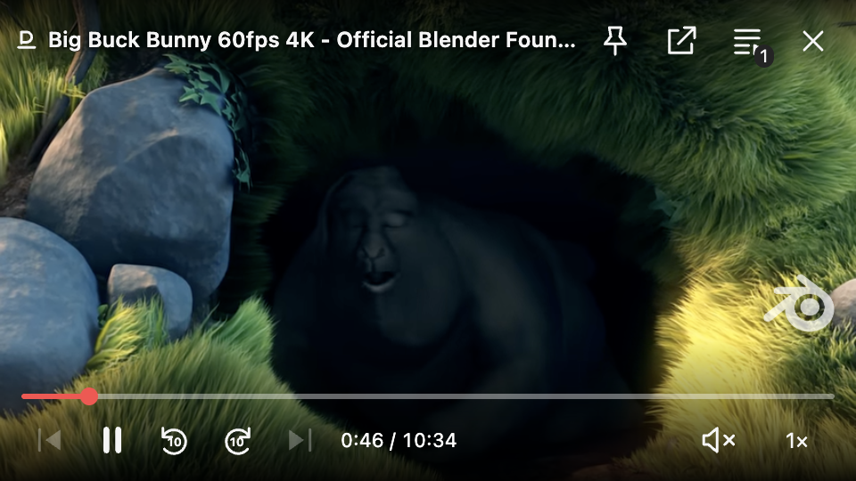

# Player guide

[Back to Perch](../README.md)

## Open and queue videos

Paste a public YouTube video link, a supported HTTPS video URL, or a webpage containing a standard HTML video. Press Play. Drag a link into the link field if you prefer.

To line up more videos, open the queue button or press **Command+O**. Paste several links, one per line. **Add to queue** keeps the current video playing. **Play** starts the first pasted link. Click a queued item to play it. Drag a row or its grip to reorder it; the red line shows where it will land. The small arrows also move rows, and × removes one. Rows slide into place and buttons respond to a press; Reduce Motion removes the movement. Auto-next can advance through the queue when a video finishes. At the end of the queue, playback stops.

Duplicate links are merged, and a batch with an invalid link is rejected before changing the queue. Up to 100 videos can be queued. YouTube titles load when available; an unavailable title does not prevent playback. The queue, preferences and window position are saved locally. On relaunch, Perch opens its link screen rather than automatically playing audio.

## Move, resize and hide

Drag anywhere on the video or the empty parts of its overlay using a mouse or trackpad. A quick click plays or pauses; holding or moving starts a drag. Buttons, sliders and menus keep their normal actions. Drag a window edge or corner to resize it. The player keeps a 16:9 shape and a minimum size of 320 × 180 points. It starts unpinned. Click the pin button to keep it above other apps. It follows desktop Spaces; enable the pin to keep it above other apps, including fullscreen apps.

During a YouTube ad, the site's own controls handle Skip and playback. Click Skip when YouTube makes it available. Drag Perch's title bar to move it during an ad; video-wide dragging and Perch's bottom controls return when the ad ends.

**Option+Space** hides or shows all player windows. Revealing brings the player forward and focuses it, without changing your pin setting. It keeps video and audio running, including when auto-next changes videos. The close button pauses playback; with two players open, it closes that player and frees the slot. The last player stays available from the menu bar. **Command+Q** quits and stops playback.

If the global shortcut is already used by another app, Perch reports the conflict rather than replacing that app's shortcut. Use Perch's menu bar icon instead. Shortcuts are registered again after wake and unlock. **Reset position** in that menu brings a window back to the main display and reveals it. Reopening Perch from Applications also reveals the existing player.

## Captions, chapters and keyboard controls

**Chapters:** when YouTube provides them, a small chapter menu appears above the timeline. Choose a timestamp and title to jump there; short separators mark chapter boundaries. Videos without chapters keep the ordinary timeline. The replay-popularity graph is not included.

**Captions:** click **CC** in the top controls, or press **C** while the player is focused. A red line under CC means captions are on. The button is disabled when none are available. YouTube uses its own captions and selected language; standard HTML videos use their caption or subtitle tracks. Availability depends on the video.

Playback keys apply to the focused player. They do not intercept typing in other apps or in Perch's link field.

| Key | Action |
| --- | --- |
| Space or K | Play / pause |
| Left / Right | Back / forward 5 seconds |
| J / L | Back / forward 10 seconds |
| Up / Down | Increase / decrease volume |
| M | Mute / unmute focused player |
| C | Toggle captions, when available |
| Option+M | Mute / unmute all players from any app |
| Command+Shift+Right / Left | Next / previous queued video |
| Command+O | Open queue and links |
| Command+, | Settings |
| Option+Space | Hide / show all players, keep playing |
| Command+Q | Quit |

The timeline, speed selector and controls are keyboard accessible. Arrow keys on a focused slider adjust that slider rather than also seeking the video. Unseekable streams disable the timeline and seek buttons.

## Two videos at once

Open **Settings** and select **Allow two players**. It is off by default. Once enabled, pasting a new link and pressing Play while one video is open creates a second independent player. Both may play audio, and each has its own playback controls. Option+Space hides or shows both together. Option+M mutes both if either is unmuted; press it again to unmute both. Muting does not pause playback. Unmuting a player at zero volume restores its last audible volume.

A third player is refused with an explanation. Repeated Play on a link already open reuses its window. Clicking a queued video selects or replaces a player instead of opening more windows. Automatic queue advancement skips a video that is already open in the other player. Turning the setting off closes the other player and keeps the selected one.

See [verification and known limits](VERIFICATION.md) for tested builds. Screenshot credits are in the [README](../README.md#credits-and-licence).
